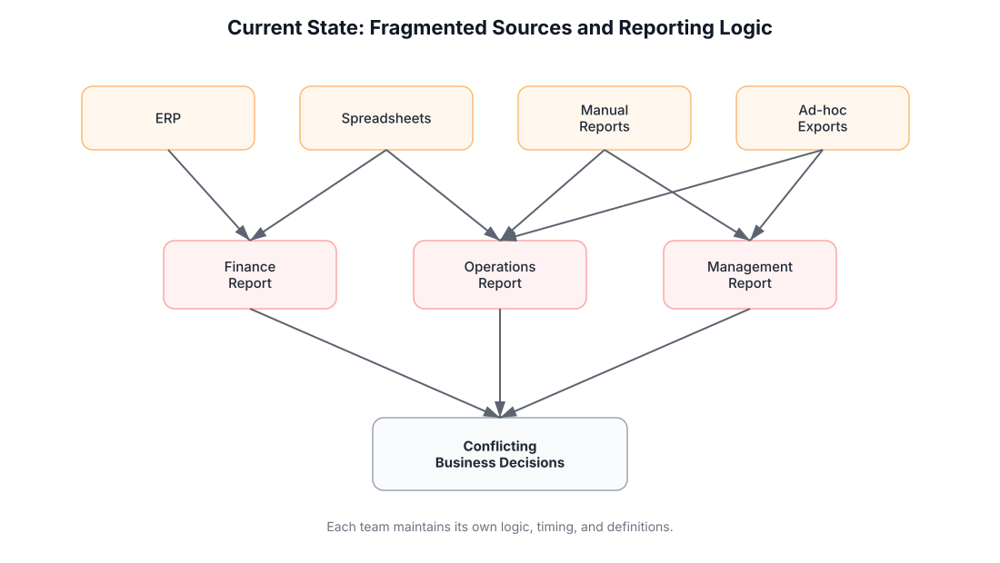
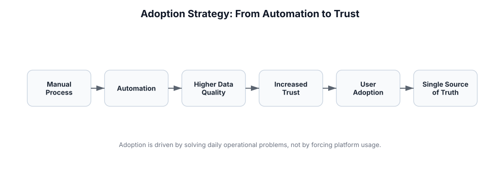
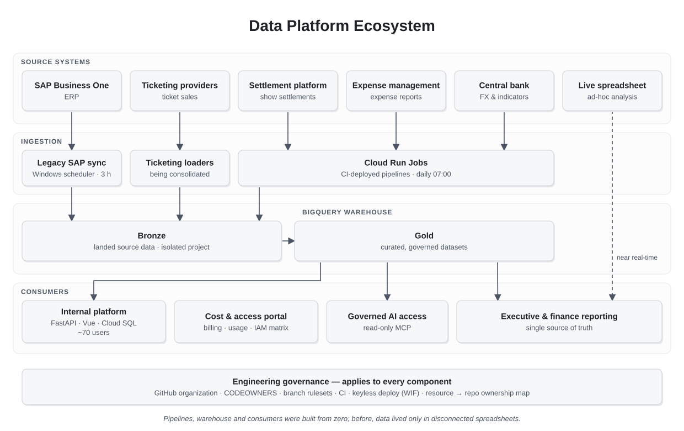
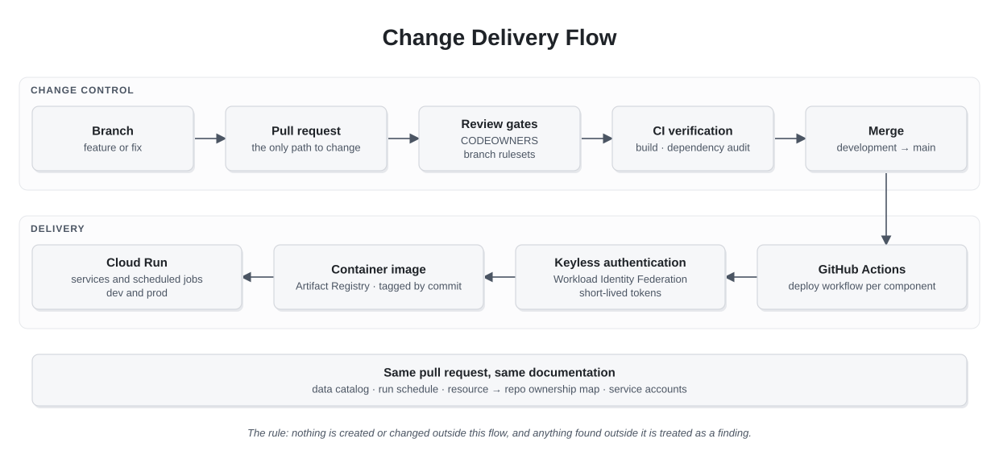

# Building a Single Source of Truth: A Data Platform Function Built From Zero

## Executive Summary

This case study documents how I built the data and platform function of a company that did not have one.

When I joined a large live entertainment production company in Chile, there was no data warehouse, no internal software platform, no engineering team and no technology area in the organization chart. Business data lived in disconnected spreadsheets, each with its own structure, and consolidating it for reporting took hours of manual work.

Over the following months I designed, built and now operate an ecosystem that includes:

- a BigQuery data warehouse that integrates the ERP, the settlement platform, ticketing providers, expense management and central bank indicators
- an internal platform used across the company by approximately 70 people
- engineering governance for every component: pull-request-based change control, code owners, CI/CD and keyless deployment
- a cost and access observability portal for the cloud environment
- governed, read-only access for AI assistants to the warehouse

Because there was no previous system, most outcomes in this case study are capabilities that did not exist before, not improvements measured against a baseline. Where a real before-and-after comparison exists, it is stated explicitly.

The platform is in active use and still evolving.

---

# Context

The company is a finance-led organization of approximately 70 people. Its operations revolve around shows: each one involves ticket sales through external providers, settlements with partners, expenses, accounting in the ERP and executive reporting.

There was no technology or data area. The data and platform function did not exist as a role; it was created from Finance and is currently carried by one engineer, which is me. In practice, that means I act as data engineer, backend and frontend developer, platform and DevOps engineer, and cloud architect for the same ecosystem.

That context shaped every decision in this case study. The architecture had to be operable by one person, understandable by the next person who joins, and safe enough that a single mistake could not silently corrupt business data.

The work started in November 2025 and is ongoing.

---

# The Problem

Most organizations do not suffer from a lack of data.

They suffer from a lack of trusted data.

In this case, the problem started one step earlier: there was barely any structured data at all.

  

The starting point had five characteristics:

- **Fragmented sources.** Information lived in the ERP, an external settlement platform, ticketing providers and an expense management tool, and was combined by hand in spreadsheets.
- **No common structure.** Every spreadsheet had its own layout, so the same metric could be calculated differently depending on who prepared the report.
- **No production-side data.** There was no quantitative record of operational work, so reporting covered finance but not production.
- **Manual consolidation.** Preparing recurring reports took hours, leaving little time to review whether the numbers were right.
- **No change control.** Cloud resources could be created by hand, without a repository, an owner or documentation.

The objective was not simply to centralize data. It was to build a foundation that people could trust enough to stop maintaining their own versions of the truth, and that could be operated safely by a very small team.

---

# Design Principles

## 1. One Trusted Source

Every report, internal application and automation consumes data from the same governed platform instead of maintaining its own dataset.

## 2. Automate Data Collection

Manual data entry is replaced by scheduled ingestion wherever possible, so data quality improves without adding work for business users.

## 3. Governance Before Analytics

Definitions, ownership and validation rules are established before reports are built on top of them.

## 4. Build Once, Reuse Everywhere

Business logic exists once, in the warehouse or the platform, and every consumer reuses it.

## 5. Reduce Operational Friction

A system that makes daily work easier gets adopted. A system that adds steps does not, however technically correct it is.

## 6. Every Resource Has an Owner

Every service, job, function and dataset belongs to a repository and an owner. A resource without an owner is treated as a finding, not as background noise.

## 7. Least Privilege by Default

Service accounts, users and AI assistants receive the minimum access their task requires, and that access is visible and auditable.

## Adoption Strategy

Adoption was not imposed. It was driven by replacing repetitive manual tasks with standardized workflows, so that each automation also produced cleaner data for the platform.

  

---

# Platform Overview

The ecosystem is organized in layers: source systems, ingestion, a medallion-style warehouse in BigQuery and the consumers built on top of it. Engineering governance applies to every component.

  

## 1. Data Warehouse

The warehouse follows a medallion-style separation. Landed source data lives in an isolated project, separate from the curated, governed datasets that reports and applications consume. Separating them at the project level makes access control simpler: most users and services never need to see raw data.

Ingestion pipelines run as containerized Cloud Run Jobs, built and deployed through CI. They cover:

- **Settlements.** The pipeline first reads the canonical list of open shows from the internal platform, then retrieves their settlements from the external platform.
- **Expenses.** Expense reports, expenses, funds and policies from the expense management tool.
- **Central bank indicators.** Exchange rates and economic indicators used in financial reporting.
- **ERP.** Accounting entries, chart of accounts, business partners, projects, cost centers and purchasing documents, loaded as full reloads with row-count validation.
- **Ticketing.** Sales data from the ticketing providers, currently being consolidated into its own governed repository.

The Cloud Run pipelines refresh every morning at 07:00 and the ERP sync runs every three hours, which keeps the warehouse current for everything else. One specific report keeps a live spreadsheet path for near-real-time, ad-hoc analysis, which is a deliberate exception and is discussed under trade-offs.

## 2. Internal Platform

The internal platform is a web application with a FastAPI backend, a Vue frontend and a Cloud SQL database, deployed to Cloud Run with separate development and production environments. It is used across the company by approximately 70 people.

Besides supporting daily workflows such as budgets and show operations, the platform generated something the company never had: quantitative, structured data from the production side of the business. That data now feeds reporting from the same single source as finance.

The platform includes scheduled jobs, such as a weekly budget review digest and pre-show notifications, a weekly database backup, and database migrations that run as part of the deployment.

Security is reviewed through periodic audits of the codebase. Findings are prioritized by severity and fixed in rounds, covering areas such as authorization and privilege boundaries, session handling, rate limiting and security headers.

## 3. Engineering Governance

There was no GitHub organization, no code review and no deployment process. I created the organization and defined the rules that every repository follows today:

- every component has its own repository: platform, warehouse, cost portal and ticketing
- every change goes through a pull request
- code owners and branch rulesets enforce review on protected branches
- CI verifies each change, including a dependency audit that blocks deployments with high-severity vulnerabilities in production dependencies
- deployments run from GitHub Actions and authenticate to Google Cloud through Workload Identity Federation, so no long-lived service account keys exist
- each repository documents its data catalog, run schedule, service accounts and a map of every cloud resource to the repository that owns it

  

## 4. Cost and Access Observability

A portal built on cloud billing data shows costs, resources, usage and a data dictionary in one place.

Its permissions view answers a question that is hard to answer from the cloud console: who can read or write each BigQuery table? It calculates the effective permission of every user, group and service account on every table by combining project-level IAM, dataset access entries and table-level IAM, and it expands group membership. The view states its own limits explicitly, such as inherited organization-level roles and row-level security, which it does not evaluate.

The portal's service account can read access policies and metadata, but not the data inside the tables. Access to the portal itself is granted per user through identity-provider claims.

## 5. Governed AI Access

AI assistants reach the warehouse through a Model Context Protocol (MCP) server that I built and operate. Each user connects with their own identity, sees exactly what their permissions allow, and can only run read-only queries, with a per-query cost cap. The read-only restriction is enforced by the identity provider's OAuth scope, not only by application code.

This replaced a vendor connector that offered full permissions and no organizational control. It is the technical foundation of the company's AI adoption strategy, which prioritizes governance and secure access before broader rollout.

The design, its security model and its validation are described in [Governed AI Access to a Data Warehouse Through MCP](../11-governed-ai-access-bigquery-mcp/).

---

# Key Engineering Decisions

## 1. Decide Ownership by Lifecycle, Not by Runtime

Where a process runs (Cloud Run, a scheduler or a third-party system) does not decide which repository owns it. The deciding question is whose changes can break it. A pipeline that exists to serve the internal platform lives with the platform; a component with independent value gets its own repository.

## 2. Separate Raw and Curated Data at the Project Level

Isolating landed source data in its own project keeps permissions simple and reduces the chance that a report reads unvalidated data.

## 3. Deploy Without Long-Lived Keys

Workload Identity Federation lets CI authenticate with short-lived tokens. There are no service account keys to rotate, leak or forget.

## 4. Enforce Read-Only AI Access at the Identity Layer

Restricting AI assistants through the OAuth scope means that even a bug in the MCP server cannot turn a read into a write.

## 5. Ship Documentation in the Same Pull Request

The data catalog, run schedule and resource ownership map are updated in the same pull request as the change they describe. Documentation that lives elsewhere drifts.

## 6. Keep One Live Spreadsheet Path Where It Earns Its Place

One report needs near-real-time, ad-hoc analysis that a daily batch cannot provide. Instead of forcing it into the warehouse, the live spreadsheet path was kept deliberately and documented as an exception.

## 7. Define Failure Behavior Explicitly

The settlements pipeline fails completely if the internal platform is unavailable, instead of loading partial data. Partial failures on individual shows are not retried automatically, to avoid duplicate records; they are reported in the run summary for review.

---

# Operational Findings

Building the governance layer surfaced problems that would otherwise have stayed invisible:

- **Resources without an owner.** An inventory of all compute resources across the cloud projects found services and functions that had been deployed by hand, with no repository. Each one was assigned an owner, moved into a repository or deleted.
- **Accumulated ephemeral jobs.** Database migration jobs created during deployments were supposed to be deleted after each run, but the cleanup step did not always execute. 139 leftover jobs were purged, and the gap was documented.
- **Documentation drift.** The documented schedule for one pipeline did not match the real one. It was corrected, and that mismatch is the main reason documentation now ships in the same pull request.
- **Dependency vulnerabilities.** The CI audit blocked a deployment because of a high-severity vulnerability in a transitive dependency. It was fixed with a minimal lockfile update, and the remaining moderate findings were accepted with a written rationale instead of a breaking downgrade.

---

# Results

## Baseline

There was no data warehouse, no internal platform, no structured production data and no engineering process. The only data available was in disconnected spreadsheets with different structures.

## What Exists Now

- A single source of truth that integrates five source domains: the ERP, the settlement platform, ticketing providers, expense management and central bank indicators.
- An internal platform used across the company by approximately 70 people.
- For the first time, quantitative data from the production side of the business, available from the same source as financial data.
- A warehouse refreshed every morning, plus a deliberate near-real-time path for the one report that needs it.
- Engineering standards that every component follows: pull-request-based change control, code owners, CI with dependency auditing, keyless deployment and a resource ownership map.
- Visibility into cloud costs and into who can access each table.
- Governed, read-only AI access to company data.

## The One Direct Comparison

Recurring report processing went from hours of manual consolidation to minutes.

The more important effect was how that time was used. Instead of running to produce numbers, the team now spends it improving the reports and reviewing the data before it is delivered. Report quality and trust in the data improved without adding processing time.

---

# Trade-Offs and Risks

## A Single Engineer

The whole function depends on one person. Governance, documentation and keyless automation reduce that risk, because the system can be understood and rebuilt from its repositories, but they do not remove it. This is the most important open risk of the platform.

## Legacy ERP Synchronization

The ERP sync still runs on a Windows scheduler on an internal machine instead of in the cloud, outside the standard delivery flow. It works, but it is the least observable pipeline.

## Ticketing Ingestion Before Governance

Part of the ticketing ingestion predates the governance model and is being moved into its own repository.

## Full Reloads

Several pipelines truncate and reload their tables. This is simple and easy to validate at the current data volume, but cost and runtime will grow with it.

## Two Paths for One Report

The live spreadsheet path and the daily warehouse can diverge. It is accepted because that report needs fresher data than a daily batch provides, and the exception is documented.

## Coupling Between Platform and Warehouse

The settlements pipeline reads from the internal platform's database. Schema changes in the platform can break the pipeline, so they are coordinated explicitly between both repositories.

---

# Lessons Learned

## 1. Technology Is Rarely the Hardest Problem

Building pipelines and applications was the simpler part. Building enough trust that people stopped maintaining their own spreadsheets took longer.

## 2. In a Greenfield, Standards Are the Deliverable

With nothing to compare against, the most durable outcome is not any single pipeline but the rules every future component will follow.

## 3. An Inventory Is a Security Control

Resources that nobody knows about cannot be secured, patched or paid for consciously. The resource ownership map found more risk than any code review.

## 4. Documentation Drifts Unless It Ships With the Change

Every documentation error found during this work came from documentation written separately from the change it described.

## 5. AI Governance Starts With Identity

Safe AI access to company data was not achieved through prompts. It came from identity, scopes and the same permission model that applies to people.

---

# What I Would Do Differently Today

## Measure From Day One

Because no baseline was captured, most results can only be described as capabilities created. Recording simple metrics before the first pipeline, such as hours spent on reports, number of active spreadsheets and report lead time, would have made the impact measurable.

## Create the Ownership Map Before the First Deployment

The inventory came after resources already existed. Starting with it would have prevented orphaned resources entirely.

## Introduce Data Contracts Earlier

Explicit contracts between the internal platform and the warehouse would replace manual coordination of schema changes.

## Automate Drift Detection

A scheduled check comparing deployed resources against the ownership map would catch manual deployments and leftover jobs automatically.

## Plan for the Second Engineer Earlier

Documentation and automation were designed so someone else could take over. Making that an explicit organizational goal sooner would reduce the single-engineer risk faster.

---

# Next Steps

- Consolidate ticketing ingestion into its own governed repository.
- Move the ERP synchronization into the standard cloud delivery flow.
- Formalize data contracts between the internal platform and the warehouse.
- Expand governed AI access as the company's AI adoption progresses.
