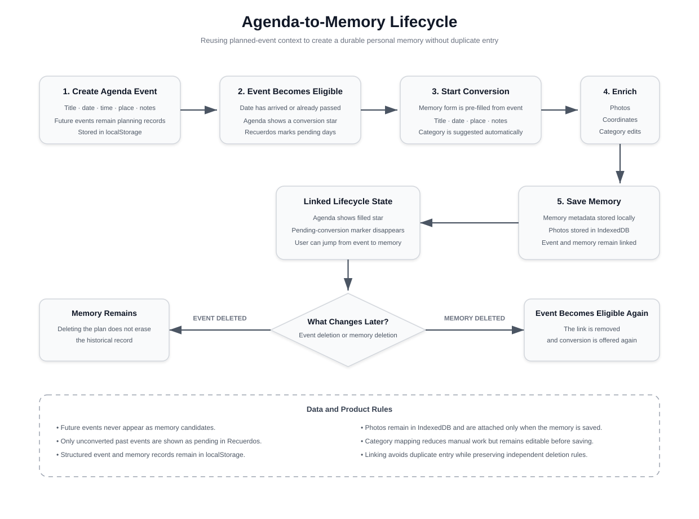
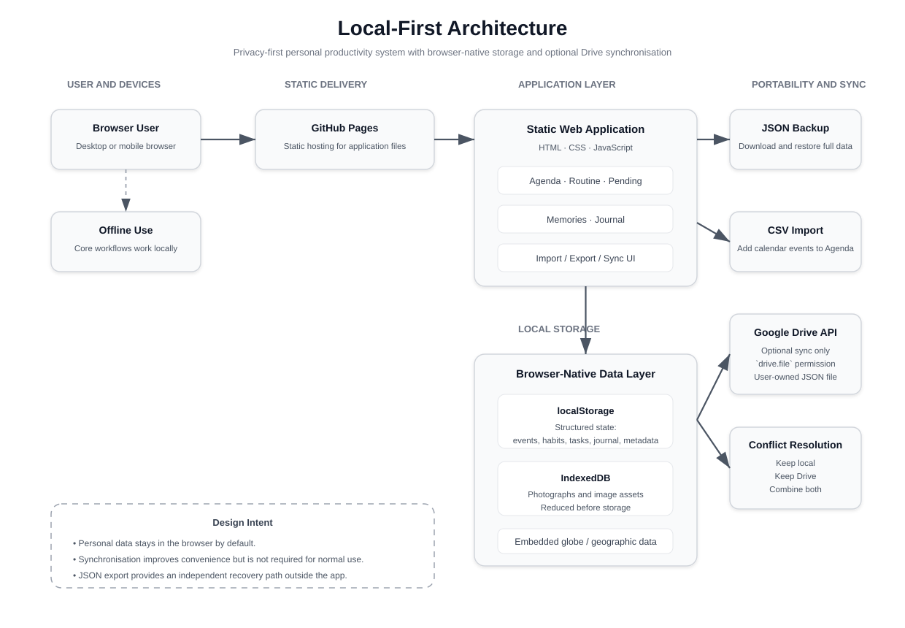
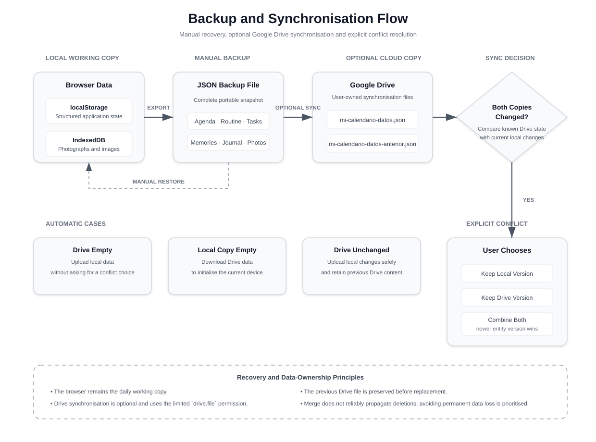

# Building a Privacy-First Personal Productivity System


## Executive Summary

This case study documents the design and rapid implementation of a personal productivity web application built to replace a fragmented collection of calendars, task managers, habit trackers, journals and memory applications.

The project started from a recurring personal problem: every productivity tool solved only part of the workflow.

Some applications displayed calendar information well but were weak for day-to-day tasks. Others supported task management but not journaling, memories, habits or personal metrics. Paper offered unlimited flexibility, but it was too slow to maintain consistently.

Instead of continuing to adapt my workflow to multiple incomplete tools, I designed a web application around the way I actually wanted to organise information.

The resulting system integrates:

- calendar planning
- multi-day events
- monthly and yearly views
- day-to-day task groups
- habit tracking
- personal metrics and charts
- journal entries
- expense tracking with monthly budgets
- linked notes with a network view, compatible with Obsidian
- memories with photographs
- geographic visualisation of memories, with KML and GPX import and export
- manual JSON backup and restore
- CSV event import
- optional Google Drive synchronisation
- installable, offline-capable use as a progressive web app
- static deployment through GitHub Pages

The functional 80/20 of the product was implemented in less than a day with the support of AI coding agents.

However, the main engineering lesson was not that AI could generate code quickly.

The speed came from combining:

- a clearly defined personal problem
- explicit product requirements
- deliberate architectural restraint
- prior knowledge of browser storage, APIs and static hosting
- concise and testable instructions for AI coding agents
- immediate validation against a real workflow

The first version was built in July 2026. Over the following months, real daily use led to two new sections, Wallet and Notes, and to turning the application into an installable progressive web app.

In October 2026 I audited the application as if I had inherited it, and fixed the findings one by one in order of severity. The most important one was a critical data-loss path in the Drive synchronisation, described in [Hardening Through a Structured Audit](#hardening-through-a-structured-audit).

The project demonstrates how clear problem framing and proportional architecture can turn AI-assisted implementation into a useful product rather than an isolated prototype.

---

# Related Repository

**[sspratz96/mi-almanaque-personal](https://github.com/sspratz96/mi-almanaque-personal)**: the application's source code. Personal data is never stored in the repository; it stays in the user's browser unless Google Drive synchronization is enabled.

---

# Context

For years, I had difficulty maintaining a single planning system.

Most applications required compromises:

- a calendar might show upcoming events clearly but lack flexible daily tasks
- a task manager might handle pending work but not habits or journaling
- a journal might capture reflections but remain disconnected from planned events
- a memory application might preserve past experiences but not connect them to the calendar
- combining all these needs required several subscriptions and disconnected interfaces

Paper initially appeared to solve the flexibility problem.

A handwritten system could be designed without interface restrictions, but writing and maintaining repeated structures was slow. The cost of updating the system eventually outweighed its benefits.

This led to a different question:

> What if the productivity system adapted to my workflow instead of forcing my workflow to adapt to the system?

The answer became Mi Almanaque: a personal web application designed around one user's exact planning, tracking and reflection needs.

---

# The Problem

The problem was not a lack of productivity software.

It was fragmentation.

Information about the same life existed in different tools:

- future plans in a calendar
- immediate tasks in notes or messaging groups
- habits in a tracker
- personal metrics in spreadsheets
- reflections in a journal
- photographs and memories in another application
- backups in yet another service

This fragmentation created duplicated work and weak relationships between information.

For example, an event might first be entered in a calendar and later rewritten as a memory after it occurred.

The desired system needed to support the full lifecycle of personal information:

```text
Plan what will happen
        ↓
Manage what needs attention
        ↓
Track recurring behaviour
        ↓
Record what happened
        ↓
Preserve and revisit memories
```

It also needed to meet several non-functional constraints:

- no recurring cost
- no custom backend
- no database administration
- privacy by default
- usable on desktop and mobile
- portable data
- recoverable backups
- optional cross-device synchronisation
- minimal deployment complexity
- resilience when internet access was unavailable

---

# Product Principles

## One Integrated Personal System

Planning, tasks, routines, journaling and memories should live in one coherent interface.

## Local-First by Default

The application should work without sending personal information to a third-party backend.

## User-Controlled Data

Data should be exportable, restorable and understandable without depending on a proprietary service.

## Optional Cloud Synchronisation

Cloud storage should improve convenience without becoming mandatory for normal use.

## Zero Operational Infrastructure

The application should not require a server, managed database or paid hosting service.

## Fast Iteration

The architecture should make it easy to change the product as personal requirements evolved.

---

# Product Scope

The application contains seven connected sections.

## Agenda

The Agenda supports:

- monthly calendar navigation
- daily detail views
- yearly overview
- timed and all-day events
- multi-day events
- categories and colours
- editing and deletion
- CSV event import
- conversion of past events into memories

## Routine

The Routine section supports:

- monthly habit tracking
- editable habits
- per-month habit selection
- configurable frequency
- personal metrics
- automatic charts
- monthly completion percentages
- daily notes
- importing habits and metrics from a previous month
- preserving historical data when a habit is no longer active

## Pending Tasks

The Pending section supports:

- task groups by topic
- custom colours and emojis
- completion state
- editing and deletion
- subtasks and priority markers
- group reordering
- bulk removal of completed tasks

## Wallet

The Wallet supports:

- two-tap expense and income entry
- categories with emojis, colours and a type that sets the sign of each movement
- optional monthly budget caps per category, copied from the previous month on request
- monthly totals, daily average and a day-by-day chart
- registering scheduled bills from the Agenda without retyping them
- CSV export of all movements

The Wallet is the only section where data has to reconcile. Only movements are stored; totals, charts and budget progress are calculated every time the section opens, so what is recorded and what is displayed cannot drift apart.

## Memories

The Memories section supports:

- dated memories
- categories and colours
- photographs
- yearly navigation
- connection with past calendar events
- latitude and longitude
- a rotatable world globe showing where memories occurred
- folders for grouping places, placing a memory by tapping the globe, and KML, KMZ and GPX import with duplicate detection
- KML export by folder for use in offline map applications

## Journal

The Journal supports:

- dated entries
- mood
- optional titles
- personal free-form text

## Notes

The Notes section supports:

- reading notes, ideas and projects with type, source and tags
- links between notes with `[[double brackets]]`, backlinks and automatic link updates on rename
- basic Markdown with a small formatting toolbar
- a network view where linked notes cluster together
- Markdown import and export compatible with an Obsidian vault

The value of the product comes not only from these modules individually, but from the relationships between them.

---

# Connecting Plans to Memories

<p align="center">
  
</p>

One of the most useful workflows connects Agenda and Memories.

Without this connection, an activity had to be entered twice:

1. once before it happened, as a planned event
2. again afterward, as a memory

The application allows past events to be converted into memories.

The conversion workflow:

- retrieves the event title
- copies the date and location
- carries over notes
- suggests a memory category
- allows photographs and coordinates to be added
- links the new memory back to the original event
- prevents the same event from being offered repeatedly

If the memory is deleted, the original event becomes eligible for conversion again.

If the event is deleted, the memory remains because the historical record should not disappear with the plan.

> Integrated systems should reduce repeated data entry by using existing context.

---

# Local-First Architecture

The application uses a deliberately simple browser-based architecture.

<p align="center">
  
</p>

There is no custom backend and no managed application database.

The repository contains only application code.

Personal events, journal entries, tasks, routines, memories and photographs remain in the user's browser unless synchronisation is explicitly enabled.

---

# Storage Design

## localStorage

localStorage holds structured application state such as:

- events
- task groups
- habits
- metrics
- journal entries
- memory metadata
- wallet movements, categories and budgets
- notes
- preferences and configuration

It was selected because it is simple and sufficient for the scale of a personal application.

## IndexedDB

Photographs and uploaded images are stored in IndexedDB.

This avoids placing large binary values in localStorage and provides a more appropriate browser storage mechanism for image content.

Images are reduced before storage to lower browser-space consumption.

The separation kept the implementation lightweight while recognising that not all browser data has the same storage characteristics.

---

# Portable Backups

Local-first software creates an important responsibility: the user must be able to recover and move their data.

The application therefore includes three data operations.

## Download JSON Backup

The application can export the complete personal dataset, including application information and stored photographs, into a JSON file.

## Restore JSON Backup

A backup file can replace the current browser state and restore the application on another device.

## Import Calendar Events from CSV

A CSV import adds events to the Agenda without replacing the rest of the system.

The mental model is intentionally simple:

```text
Browser = daily working copy
Drive   = optional synchronisation
JSON    = independent safety backup
```

---

# Optional Google Drive Synchronisation

The application can synchronise its data through the user's own Google Drive.

This capability was designed as optional infrastructure rather than as a dependency.

The integration uses the `drive.file` permission.

This means the application can access only the file it creates, rather than obtaining general access to the user's Drive.

The design provides:

- cross-device portability
- no custom server
- no database account
- no recurring infrastructure cost
- limited Drive permissions
- user ownership of the synchronisation file

---

# Synchronisation Conflict Handling

<p align="center">
  
</p>

Synchronisation becomes difficult when local and remote copies both change.

The application avoids silently deciding which version survives.

It distinguishes among several conditions.

## Empty Remote or Empty Local State

The data is copied in the obvious direction without requiring a conflict decision.

## Remote Copy Unchanged

Local changes can be uploaded safely.

## Both Copies Changed

The application displays a comparison and offers three options:

- combine both versions
- keep the Drive version
- keep the local version

The combine option merges events, memories, journal entries, habits, metrics and tasks.

When the same entity exists on both sides, the newer version is retained.

Deletion is handled conservatively.

A deletion performed on one device may not propagate through a merge if the other device still contains the record.

This trade-off favours recovering an unwanted record over permanently losing wanted information.

---

# Synchronisation Safety Net

Before replacing the primary Drive file, the application stores the previous content in a second backup file.

Google Drive's own file-version history provides another layer of protection.

The approach follows a defence-in-depth model:

- current browser data
- current Drive synchronisation file
- previous Drive copy
- Drive version history
- manually downloaded JSON backups

For a personal system, this was a more proportionate solution than building a full synchronisation backend.

---

# Offline and Cross-Device Use

The application is deployed as static files through GitHub Pages.

Once loaded, the main product can operate without a network connection because:

- application logic is local
- personal data is stored in the browser
- inspirational quotes are included locally
- geographic outlines are embedded in the application
- the world globe does not depend on an external map service

Internet access is required only for optional Drive synchronisation and initial page delivery.

A service worker makes this explicit. The application shell is served network-first, so a new deployment reaches the phone quickly, with the cache as a fallback when there is no connection. Static assets are served cache-first, and Google authentication and Drive requests always bypass the cache.

A web app manifest makes the application installable on the home screen, with shortcuts for the most frequent actions: recording an expense, checking off today's routine and writing in the journal.

The responsive interface allows the same deployment to be used from desktop and mobile browsers.

---

# Embedded Geographic Visualisation

The Memories section includes a rotatable world globe.

Memories containing coordinates appear as coloured points based on category.

The geographic data is based on simplified Natural Earth boundaries embedded directly in the application.

This avoids:

- external map images
- map-service accounts
- runtime map API dependencies
- network requirements for normal rendering

The 3D library that renders the globe is also served from the application's own files instead of a third-party CDN, which removed the last external runtime dependency of the core product.

Memories can be grouped into folders, placed by tapping a point on the globe, imported from KML, KMZ and GPX files, and exported as KML so the same places can be used in offline map applications.

Embedding and simplifying the geometry kept the application self-contained while still providing a meaningful visual way to revisit personal history.

---

# Rapid AI-Assisted Development

The first useful version of the application was built unusually quickly.

Approximately 80 percent of the functional value was implemented in less than a day with the support of Codex and Claude.

That speed should not be interpreted as the AI agents independently designing the product.

The effective workflow depended on four human contributions.

## 1. Clear Problem Definition

The project began with a concrete description of what existing tools failed to provide.

The workflows, constraints and desired relationships were articulated before implementation.

## 2. Prior Technical Knowledge

Knowing how browser storage, static applications, OAuth, Google APIs and GitHub Pages worked made it possible to select a viable architecture immediately.

## 3. Small, Precise Instructions

The AI agents received bounded implementation tasks rather than one broad request to build a productivity app.

Instructions focused on specific modules, behaviours and acceptance conditions.

## 4. Immediate Validation

Generated changes were tested against a real personal workflow.

Features were accepted, corrected or refined based on whether they solved the original problem.

The AI agents accelerated implementation.

Problem framing, architecture, prioritisation, validation and product coherence remained human responsibilities.

---

# Problem Framing as an Engineering Tool

A major lesson from the project was the importance of writing the problem clearly before writing code.

This principle is sometimes described informally through Kidlin's Law: a clearly written problem is already partly solved.

The useful engineering interpretation is more concrete.

Clarifying the problem made it possible to define:

- what information belonged in the system
- how the modules related to each other
- what data had to remain private
- what could work locally
- what required cloud connectivity
- which workflows created duplicated effort
- which features belonged in the initial 80/20
- what could be postponed

AI-assisted implementation became effective because ambiguity had already been reduced.

---

# Hardening Through a Structured Audit

After three months of daily use, I audited the application as if I had just inherited it, following the same method I use for professional repositories: security first, then failure modes, performance, dead code and maintainability. Each finding was fixed in its own commit, in order of severity.

The most important findings were in the parts designed to protect data:

- **Critical: a Drive error could erase the data it was meant to protect.** An HTTP error while downloading from Drive, such as a permission or rate-limit response, was interpreted as an empty Drive. The synchronisation then took the "Drive is empty" path and overwrote both the Drive file and its safety copy. The fix treats every non-successful response as an error, validates that a downloaded payload contains real data before any decision is made, and never overwrites the safety copy with an invalid payload.
- **High: the merge could lose edits.** Most records did not carry a per-item edit timestamp, so the "newest version wins" rule could not work reliably for them.
- **Automatic uploads without coordination.** Automatic pushes to Drive now share a write lock with manual synchronisation, are pinned to the Drive version they were based on, and show visible errors instead of failing silently.
- **Local saving could switch itself off.** After a storage quota failure, local saving stayed disabled for the rest of the session.
- **Smaller failure modes.** The current date froze if the application stayed open past midnight, the search for the Drive file was not deterministic when duplicates existed, and removing a photo while editing a memory was destructive before saving.

Security fixes included neutralising spreadsheet formulas in CSV exports and self-hosting the 3D library. Performance fixes calculated yearly views in a single pass and rendered only the active section.

The lesson was uncomfortable but useful: the riskiest code in the application was its safety net. A recovery path is rarely exercised, so it needs more scrutiny than the features it protects, not less.

---

# Key Engineering Decisions

## 1. Build a Static Application Instead of a Full Web Platform

A personal single-user application did not justify a custom backend, server-side authentication or managed database.

## 2. Keep Personal Data Out of the Repository

The public repository contains code only.

Personal content remains in browser storage or the user's own Drive file.

## 3. Make Cloud Features Optional

The product remains useful without Google Drive.

Synchronisation improves convenience but does not define the core architecture.

## 4. Separate Structured and Binary Storage

localStorage was used for compact structured state, while IndexedDB handled photographs.

## 5. Prefer Explicit Conflict Resolution

When both local and remote copies change, the user chooses how to proceed.

## 6. Embed Critical Visual Assets

The globe's geographic data is included in the application so that core visualisation remains available offline.

## 7. Store Transactions, Derive Totals

In the Wallet, only movements are stored. Every total and chart is recalculated, so the displayed numbers cannot disagree with the recorded ones.

## 8. Optimise for One Real User

The application was deliberately shaped around a specific workflow rather than attempting to become a generic productivity SaaS product.

---

# Trade-Offs

## Simplicity vs. Modularity

The application is primarily implemented in a large `index.html` file containing HTML, CSS and JavaScript.

This enabled very fast iteration and zero-build deployment.

However, it also creates limitations in:

- separation of concerns
- maintainability
- reusable components
- automated testing
- team collaboration
- long-term extensibility

For a personal prototype and evolving single-user application, the trade-off was acceptable. As the application grew to seven sections, `index.html` reached roughly 320 KB, which makes this the main structural debt of the project.

## localStorage vs. Structured Database

localStorage does not provide queries, relational constraints, formal migrations or strong transaction support.

The architecture works because the application is single-user and personal.

## Browser Storage vs. Universal Availability

Data stored locally belongs to a specific browser and device.

JSON backups and Drive synchronisation reduce this limitation, but the experience remains different from a centrally hosted account-based application.

## Conservative Merge vs. Deletion Propagation

The synchronisation merge can reintroduce deleted records.

This is less elegant than tombstone-based deletion tracking, but it reduces the risk of accidental permanent loss.

The "newest version wins" rule also depends on each device's clock. A device with a badly skewed clock can make the merge choose the wrong version.

## Zero Backend vs. Advanced Collaboration

The architecture cannot support real-time multiuser collaboration, server-side automation or centralised analytics without substantial changes.

Those capabilities were outside the product's purpose.

---

# Results

The project produced a usable personal system rather than a disconnected technical demonstration.

The resulting application:

- consolidates multiple personal-information workflows, including expenses and linked notes
- reduces duplicate entry between planning, memories and payments
- works without a custom backend
- keeps personal data local by default
- supports desktop and mobile use
- operates offline after loading and installs as a home-screen application
- provides independent backup and restore
- enables optional Drive-based synchronisation
- avoids recurring hosting and database costs
- can evolve quickly as personal requirements change
- has been audited and hardened after months of real use

The project also validated a broader development approach.

A clearly scoped problem, modest architecture and effective use of AI coding agents made it possible to move from idea to functional product in hours rather than weeks.

---

# Lessons Learned

## 1. Personal Software Can Be More Valuable Than Generic Software

A system designed around one real workflow can remove friction that generic products cannot anticipate.

## 2. Architecture Should Match the Actual Scale

A backend, framework and database would not automatically make the product better.

## 3. Local-First Requires Recovery Design

Keeping data local improves privacy, but backup, portability and conflict handling must be designed intentionally.

## 4. AI Accelerates Clear Work More Than Ambiguous Work

The agents were most effective when the task had explicit behaviour, constraints and acceptance criteria.

## 5. Integration Creates More Value Than Feature Count

Connecting planned events to memories was more useful than adding another isolated module.

## 6. Data Ownership Improves Product Trust

Exportable JSON, limited Drive permissions and no proprietary backend make it easier to understand where personal information exists.

## 7. Safety Nets Need the Most Scrutiny

The critical bug found in the audit was in the code meant to prevent data loss. Recovery paths run rarely, so their defects stay hidden until the moment they matter most.

---

# What I Would Do Differently Today

## Modularise the Application

I would separate the application into modules for state management, storage, synchronisation and each product area.

## Add Automated Tests

The most important areas for automated coverage would be:

- event-to-memory linking
- monthly habit behaviour
- backup and restore
- merge conflict resolution
- date handling
- synchronisation decisions

The critical synchronisation bug found in the audit is the strongest argument: a test that simulated a failed Drive download would have caught it before it could cause harm.

## Add Formal Data Versions

Backup files should contain an explicit schema version and migration process.

## Improve Deletion Synchronisation

A production-grade merge would track deletion tombstones so that intentional removals could propagate safely.

## Add Accessibility Validation

A formal accessibility review would improve keyboard navigation, focus management, semantic structure and screen-reader support.

---

# Future Architecture

```text
Modular Progressive Web Application
              │
      ┌───────┼────────┐
      ▼       ▼        ▼
 IndexedDB  Local UI  Service Worker
      │                │
      └───────┬────────┘
              ▼
      Versioned Sync Engine
              │
      User-Owned Cloud Storage
              │
       Optional API Services
```

The application is already an installable progressive web app with a service worker. A future version could add:

- structured IndexedDB repositories
- background synchronisation
- versioned migrations
- deletion tracking
- encrypted backups
- modular components
- automated test coverage

The architecture should evolve only when those capabilities create real value for the user.

---

# Final Takeaway

The most important result of this project was not the number of features built in one day.

It was proving that rapid AI-assisted implementation becomes useful when it is built on top of clear requirements, appropriate architecture and active human validation.

The project began with an everyday frustration: personal information was fragmented across too many incomplete tools.

By defining the problem precisely and resisting unnecessary infrastructure, I was able to create a privacy-first system that matched the workflow instead of forcing the workflow to match the software.

> Clear problem framing and architectural restraint turned AI-generated code into a coherent personal product.
