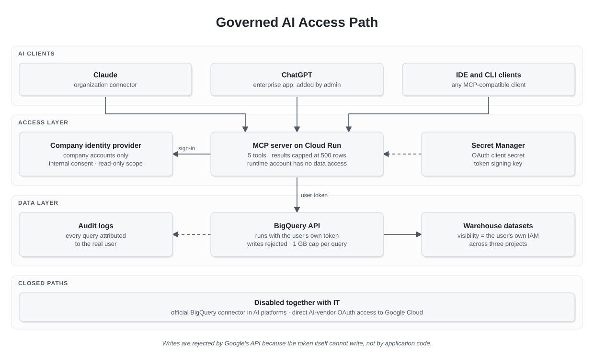

# Governed AI Access to a Data Warehouse Through MCP

## Executive Summary

Employees had started connecting AI assistants such as Claude and ChatGPT directly to the company's BigQuery data warehouse. Through those connections, the assistants inherited each user's full permissions, including write access for people who legitimately need it for their daily work, and there was no limit on how much data a single prompt could scan.

The goal was not to stop people from using AI with company data. It was to make that use safe by default.

I built and operate a Model Context Protocol (MCP) server that every AI client now uses to reach the warehouse. Each user connects with their own company identity and sees exactly the data their permissions allow, but through AI they can only read, and each query is capped at 1 GB scanned. Together with the IT team, we disabled the vendor connectors that offered full permissions, so the governed path is the only path.

The read-only guarantee does not depend on my code. It is enforced by Google's API through the OAuth scope of the user's token, and it was validated by having a project owner attempt a delete through the AI: Google rejected it.

This case study extends [Enterprise AI Workflows on Governed Data](../04-enterprise-ai-workflows/). That case focused on making AI answers reliable through data and metadata design. This one focuses on making AI access safe through identity design.

---

# Context

The company is a finance-led organization of approximately 70 people, with a data platform built on BigQuery. Its development is described in [Building a Single Source of Truth](../01-building-a-single-source-of-truth/).

Some employees need write access to warehouse tables as part of their daily work, typically through forms and operational workflows. The same employees had started using AI assistants, and several of them were connecting those assistants to BigQuery.

Experience with AI tools had already shown the risk. Imprecise prompts had produced unintended actions in other tools, from duplicated folders to a spreadsheet whose language settings changed unexpectedly. These were small, recoverable incidents. A write to a financial table, or a query scanning tens of gigabytes, would not be.

In parallel, IT and Finance, the two areas with the most experience using AI, were working together on good practices for AI use across the company. This project became the technical side of that effort.

---

# The Problem

Detecting AI access was possible. Controlling it was not.

When an assistant connects to Google Cloud through the user's OAuth consent, it acts as that user. Every permission the user has, the assistant has.

- **Identity cannot be split by client.** IAM conditions cannot grant different permissions depending on whether a request came from the console or from an AI assistant.
- **User agents are telemetry, not security.** Audit logs can show which client made a request, but a user agent can be spoofed, so it can only support monitoring, never enforcement.
- **No cost guardrail.** A poorly phrased prompt could trigger a full scan of a large table, and the vendor connector had no per-query limit.
- **No organizational control.** The vendor connector exposed full permissions, with no way to restrict scopes, cap costs or limit access to company accounts.

---

# Requirements

The requirement was summarized as **same eyes, read-only**:

- the AI sees exactly what the user can see, no more and no less
- the AI can never write, even when the user can
- every query has a hard cost cap
- only company accounts can connect
- any MCP-compatible client works through the same path
- nothing needs to be maintained per dataset or per table

---

# Options Considered

## 1. Monitor Only

Keep the vendor connectors and alert on AI traffic in the audit logs.

This adds visibility but no control. It would detect a harmful query after it had already run.

## 2. Shared Read-Only Service Account

Route all AI traffic through a server that queries BigQuery as a single read-only service account, with an allowlist of datasets.

This was my first design. I rejected it before deployment for three reasons:

- every user would see the union of everything the service account could read, instead of their own permissions
- the dataset allowlist would need constant maintenance as the warehouse grew
- sensitive data in any allowlisted dataset would become visible to everyone who connected

## 3. User Identity With a Read-Only Scope (Chosen)

Route all AI traffic through a server that queries BigQuery with the user's own token, requested with the `bigquery.readonly` OAuth scope.

The user's existing permissions decide what the AI can see, including table-level permissions, authorized views and row-level security. The scope decides what the AI can do: Google rejects every write made with that token, regardless of the user's role.

---

# Architecture

  

The MCP server runs on Cloud Run and authenticates users through the company's Google identity provider, with an internal consent screen restricted to company accounts. When a user connects an AI client, the server receives a Google token for that user with a read-only BigQuery scope, and every query runs with that token.

The server exposes five tools: `whoami`, `list_datasets`, `list_tables`, `get_table_schema` and `run_query`. `whoami` lets each user verify the identity and mode the assistant is operating under. `run_query` returns at most 500 rows.

The server's own runtime service account has no BigQuery permissions at all. It can only read its two secrets, the OAuth client secret and the token signing key, from Secret Manager.

The service is deployed through the same CI/CD flow as the rest of the platform: a change in its folder triggers a build and a deployment to Cloud Run.

---

# Security Model

| | Console, CLI or SDK | Through AI (this server) |
|---|---|---|
| Identity | The user | The user |
| What they can see | What their IAM allows | Exactly the same |
| What they can do | Depends on their roles | Read only |
| Cost limit per query | None | 1 GB scanned |

The controls are layered, and each one is enforced at the lowest level available:

- **Read-only access** is enforced by Google. With the read-only scope, the BigQuery API rejects job insertion and every DML or DDL statement, even for project owners.
- **Visibility** is enforced by each user's IAM. There is no list of datasets to maintain.
- **Cost** is enforced by a maximum-bytes-billed limit on every query. A query that would exceed it fails before running and costs nothing.
- **Access** is limited to company accounts through the internal consent screen and a domain check.
- **Traceability** comes from the audit logs, which attribute every query to the real user.
- **Closed paths.** Together with IT, we disabled the official BigQuery connector in the AI platforms and direct AI-vendor OAuth access to Google Cloud, so the governed server is the only route from AI to the warehouse.

---

# Validation

Before rollout, I validated the server with an MCP inspector, using a project owner account, which is the account with the most permissions to misuse.

| Test | Expected | Result |
|---|---|---|
| Sign-in through the company identity provider | Connects | Passed |
| `whoami` | Returns the real user | Passed |
| `list_datasets` | Matches the user's IAM across three projects | Passed: 28 datasets |
| `SELECT 1` | Runs | Passed |
| `DELETE` by a project owner | Rejected by Google | Rejected: missing write scope |
| Query scanning about 38 GB | Stopped by the 1 GB cap | Stopped before running, zero cost |

The `DELETE` test is the core of the design. The rejection came from the BigQuery API itself, because the token did not carry a write scope. No code in the server was involved in blocking it.

---

# Key Engineering Decisions

## 1. Enforce Read-Only at the Identity Layer

Validating SQL text in application code is fragile: parsers miss edge cases, and a bug becomes a security incident. Requesting a read-only scope moves enforcement to Google's API, where a bug in my server cannot turn a read into a write.

## 2. Inherit Permissions Instead of Duplicating Them

Using the user's own identity means the AI path follows every permission change automatically. Granting or revoking access in IAM is the only operation needed.

## 3. Operate Our Own Server Instead of the Vendor Connector

The vendor connector was faster to adopt but offered no scope control, no cost cap and no domain restriction. Owning the server makes each of those a configuration change in a repository.

## 4. Keep One Instance Always Running

AI clients register with the server dynamically, and those registrations live in memory. A cold start would erase them and break every connected client. The service keeps a minimum of one instance running, which adds a small fixed cost in exchange for stable connections.

## 5. Centralize Query Billing

All queries are billed to one project, regardless of which project the data lives in. That makes AI-driven cost visible in one place.

## 6. Keep the Tool Surface Small

Five tools cover discovery and querying. Every additional tool is another capability to secure and explain.

---

# Rollout Across Clients

The same server works for every MCP-compatible client, but each platform onboards it differently:

- **Claude:** added as an organization-level custom connector, then connected by each user with their company account.
- **ChatGPT:** added as an enterprise app by the workspace administrator, since individual developer mode does not apply in enterprise workspaces.
- **IDE and command-line clients:** connect directly to the same endpoint through the same sign-in flow.

The AI assistant built into the BigQuery console is outside the scope of this server. It works within the user's own console session and permissions, so it is governed by IAM directly rather than by this path.

---

# Operational Findings

During setup, the OAuth client secret appeared in a screenshot shared while troubleshooting. It was rotated, and the old secret was deleted. The lesson was procedural: a secret should never be displayed on screen during setup or troubleshooting, even in an internal conversation.

The service account used by an earlier AI connection, which had project-wide read access, was removed once the new path was validated.

---

# Trade-Offs and Limits

## The AI Can Read Everything the User Can Read

Read-only does not mean harmless. Any data a user can see can be sent to the AI vendor through this path. The real control for that risk is the permission model itself, together with the company's AI usage practices and enterprise agreements with the vendors.

## Free-Form SQL

The server accepts any read-only SQL instead of a fixed set of parameterized queries. That gives users flexibility for analysis, at the cost of less control over what is asked. Parameterized tools would be safer, but much less useful for open questions.

## Dependency on the Authentication Library

The server relies on its MCP framework to pass the user's upstream Google token to the tools. This behavior was validated, but it depends on the library version, so upgrades need to be tested against the same validation suite.

## In-Memory Client Registrations

Keeping one instance always running solves cold starts, but a restart still clears client registrations. Persisting them would remove the need for users to reconnect after a redeployment.

## Truncated Results

Results are capped at 500 rows. This protects the AI context and the user, but large extracts still belong in the console or in a report, not in a chat.

---

# Results

- A single, governed path from any AI assistant to the warehouse.
- Read-only access through AI for every user, including people who have write access through other channels.
- A 1 GB cost cap on every AI-driven query.
- Visibility that follows each user's existing permissions, with no lists to maintain.
- Vendor connectors with full permissions disabled, in coordination with IT.
- A technical foundation for the AI usage practices that IT and Finance are defining for the company.

---

# Lessons Learned

## 1. AI Governance Starts With Identity

The most effective control was not a prompt, a policy document or a parser. It was the scope attached to the user's token.

## 2. Enforce at the Lowest Layer Available

Every control in this design is enforced by the most fundamental layer that can enforce it: the API for read-only access, IAM for visibility, the query engine for cost. Application code only connects the pieces.

## 3. Close the Old Path When You Open the New One

A governed path only works if the ungoverned one is no longer available. Coordinating with IT to disable the vendor connectors mattered as much as building the server.

## 4. Adoption Needs Safety Before Training

People will use AI with company data whether or not it is safe. Making the default path safe protects the company while good practices are still being learned.

---

# What I Would Do Differently Today

## Design Around User Identity From the Start

The shared service account design was abandoned before deployment, but starting from the requirement of "same eyes, read-only" would have led to the final design sooner.

## Automate the Validation Suite

The validation tests were run manually. Turning them into an automated check after every deployment would protect against library upgrades and configuration drift.

## Persist Client Registrations

Storing dynamic client registrations outside memory would make the service resilient to restarts and allow it to scale to zero.

## Add Usage Reporting

The audit logs already attribute every query to its user. A simple report of AI-driven queries and bytes scanned per user would turn that data into feedback for the AI practices program.
