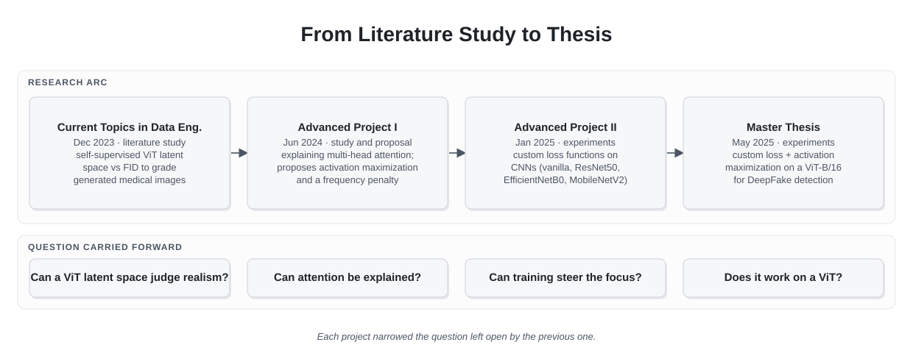
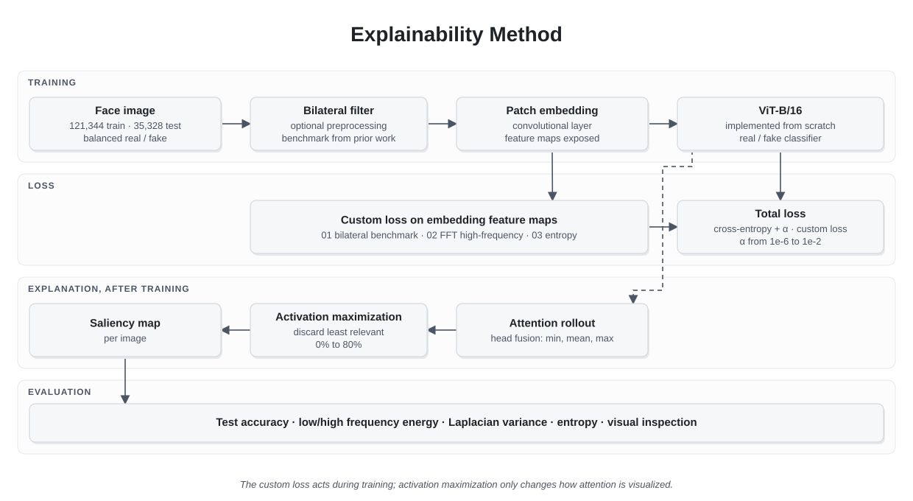

# Explainable DeepFake Detection with Vision Transformers


**Context:** MSc Data Engineering research and master thesis, Constructor University · Germany · 2023 – 2025

## Executive Summary

Vision Transformers can detect DeepFake images with good accuracy, but the explanations they produce are hard to read. Their attention tends to fall on fine, high-frequency details that people barely perceive, so the resulting saliency maps highlight scattered regions that do not match how a person would judge a face.

My master thesis tested whether that can be changed in two places:

- **During training**, with custom loss functions that penalize reliance on high-frequency features and push the model toward the broad shapes people use.
- **After training**, with activation maximization over attention rollout, to produce cleaner saliency maps.

The approach was tested on a ViT-B/16 that I implemented from scratch, trained on a public dataset of about 157,000 real and fake face images. The best model reached 90.2% test accuracy. The effect on explainability was mixed: one variant of the loss produced more focused maps, but not consistently enough to claim an improvement. The thesis presents it as a proof of concept, and so does this case study.

The thesis was the last step of a line of work that ran through the whole master program, starting with two literature studies and continuing with experiments on convolutional networks.

---

# Context

The research was part of the MSc in Data Engineering at Constructor University in Bremen, under the supervision of two faculty members. It spans four projects, each building on the previous one.

All experiments ran on Google Colab Pro+, which set the practical limits of the work: how much of the dataset could be used, which batch sizes were possible and how many configurations could be tried.

---

# The Research Question

DeepFake detection is a high-stakes use of computer vision. In forensic analysis or identity verification, knowing why a model flagged an image matters as much as the prediction itself.

Prior work showed two problems:

1. **High-frequency bias.** Models exploit fine image details that differ from the broad, low-frequency features people rely on to recognize faces.
2. **Unreadable explanations.** Because of that bias, saliency maps from standard explanation methods highlight non-contiguous areas that are hard to interpret.

One earlier study had reduced the bias by blurring the input images with a bilateral filter, and suggested that the right place to address it was the loss function rather than the input. As far as the thesis could establish, that had not been tested, and attention rollout had rarely been combined with different ways of fusing attention heads.

**Hypothesis:** penalizing high-frequency reliance during training, and applying activation maximization afterward, would produce saliency maps closer to human intuition without a large loss of accuracy.

---

# How the Research Evolved

<p align="center">
  
</p>

- **Current Topics in Data Engineering (December 2023).** A literature study on whether the latent space of a self-supervised Vision Transformer could grade the realism of generated medical images, compared with the Fréchet Inception Distance. It introduced the core concepts: self-attention, latent spaces and generated images.
- **Advanced Project I (June 2024).** A literature study on how multi-head attention works and which methods exist to explain it. It ended with a proposal: apply activation maximization to multi-head attention, and favor human-interpretable features either by preprocessing the input or by adding a high-frequency penalty to the loss function.
- **Advanced Project II (January 2025).** The first experiments. Two custom loss functions, a high-pass filter penalty and a frequency-domain penalty, were tested on a vanilla CNN, ResNet50, EfficientNetB0 and MobileNetV2, using 10% of the Food-101 dataset. The approach steered attention on the vanilla CNN and ResNet50 without a large accuracy loss, but reduced performance on EfficientNetB0 and MobileNetV2.
- **Master thesis (May 2025).** The same idea applied to a Vision Transformer and to a task where high-frequency cues matter: DeepFake detection.

---

# Method

<p align="center">
  
</p>

## Model

I implemented ViT-B/16 from scratch instead of using a library version. A custom loss needs access to the feature maps of the patch embedding layer, the only convolutional layer in a Vision Transformer, and the saliency method needs the attention matrices of every layer. A manual implementation made both available in the forward pass.

## Custom Loss Functions

The total loss is the classification loss plus a weighted penalty:

```text
L_total = L_cross_entropy + α · L_custom
```

Three penalties were developed, all applied to the embedding feature maps:

| Variant | What it penalizes |
|---|---|
| 01 Bilateral (benchmark) | The difference between feature maps and their bilateral-filtered version, reproducing the prior study's preprocessing inside the loss |
| 02 Direct | High-frequency energy, measured directly with a 2D Fourier transform |
| 03 Entropy | The amount of information in the feature maps, a more general measure of complexity |

## Explanation

Attention rollout combines the attention of all layers into one map per image. The heads of each layer were fused with the minimum, mean or maximum, and activation maximization then discarded an increasing share of the least relevant values to see whether the maps became more focused.

## Measuring Explainability

Explainability has no single metric. Besides visual inspection, the saliency maps were compared through low- and high-frequency energy, Laplacian variance and entropy, which indicate whether a map is smooth and focused or sharp and scattered.

---

# Experimental Setup

The dataset was a public DeepFake face dataset from Hugging Face, chosen because its frequency profile was the closest to the one in the prior study.

| Split | Real | Fake | Total |
|---|---|---|---|
| Train | 60,576 | 60,583 | 121,344 |
| Test | 17,664 | 17,640 | 35,328 |

Training used a guided grid search rather than a brute-force one, because each configuration took between one and a half and three hours:

- AdamW was the only optimizer, based on the earlier projects.
- A setting was explored further only when it consistently improved results.
- CutMix and MixUp lowered accuracy sharply and were dropped after a few runs.
- Larger batch sizes and larger shares of the dataset helped, but batches above 512 were too expensive to test widely.
- ViT-L/16 was tried and dropped, because its small accuracy gain did not justify the training time.

---

# Results

## Baseline Model

The best configuration used 60% of the dataset, a batch size of 512 and a cosine-annealed learning rate starting at 0.01, and reached **88.53%** test accuracy after 1 hour and 36 minutes of training.

## Bilateral Preprocessing

Filtering the input images lowered accuracy only slightly, by 0.2 to 0.5 percentage points across the five best configurations, as the prior study predicted. On average, the saliency maps became smoother and more focused, with lower Laplacian variance and entropy.

## Custom Loss Functions

Each loss was applied to the best configuration with five values of α:

| Variant | Test accuracy range | Best |
|---|---|---|
| 01 Bilateral | 84.97% – 87.48% | α = 1e-2 |
| 02 Direct | 85.47% – 90.22% | α = 1e-2 |
| 03 Entropy | 85.74% – 86.79% | α = 1e-3 |

Variant 02 at α = 1e-2 produced the best accuracy of the whole project, 90.22%, and the most specific saliency maps. The thesis is explicit that this is not conclusive: the jump from α = 1e-3 to 1e-2 was abrupt, and across all three variants it was hard to see a consistent visual improvement as α increased.

## Activation Maximization

On the baseline models, discarding up to about 30% of the least relevant values made the maps cleaner, especially with bilateral preprocessing. Beyond that, the maps lost structure. On the best custom-loss model, discarding values did not improve the visualization at all.

---

# What the Results Do and Do Not Show

They show that a frequency penalty can be added to a Vision Transformer's training without hurting accuracy, and that in one configuration it was associated with both the best accuracy and the most focused maps.

They do not show that the method reliably makes explanations more human-understandable. That would require a consistent effect across settings, a larger and more powerful model, and an evaluation with people rather than only image statistics.

---

# Key Decisions

## 1. Implement the Model From Scratch

It made the custom loss and the attention outputs possible, at the cost of not using a validated, pre-trained implementation. The thesis names this as a limitation.

## 2. Guide the Search Instead of Exhausting It

With limited compute, each result informed the next run. This found a good configuration within budget, but leaves untested combinations.

## 3. Keep the Prior Study's Filter as a Benchmark

Reproducing the bilateral filter inside the loss gave a reference point: the other two variants could be compared against a known, published approach.

## 4. Report Mixed Results as Mixed

The thesis states plainly that the effect was limited and that 90% accuracy is below the state of the art. A proof of concept is only useful if its limits are clear.

---

# Limitations

- **Compute.** Only parts of the model were trained: mainly the classifier, plus the embedding layer when a custom loss was used. Larger batches, full-dataset runs and bigger architectures were mostly out of reach.
- **Manual implementation.** The from-scratch ViT-B/16 may behave differently from standard pre-trained versions in convergence and attention patterns.
- **Model size.** ViT-B/16 is a relatively light transformer, which may limit how much a penalty on fine detail can change its behavior.
- **Evaluation.** Explainability was judged visually and with image statistics, without ground-truth regions or human evaluation.

---

# Lessons Learned

## 1. Define How Success Will Be Measured Before Running Experiments

The quantitative metrics proposed for future work, the Pointing Game and occlusion-based relevance, should have been part of the design from the start. Without them, the central question remained partly a matter of visual judgment.

## 2. Compute Budget Is a Design Constraint

Batch size, dataset share and model size were decided by what fit in the budget, and they shaped the results as much as the method did.

## 3. Build on Validated Components Where Possible

Implementing the model from scratch gave control, but it also added a source of doubt that a comparison with a standard implementation would have removed.

## 4. A Long Research Line Compounds

Each project narrowed the question left open by the previous one. The thesis was only feasible because the literature studies and the CNN experiments had already answered the basic questions.

---

# What I Would Do Differently Today

- Start from a pre-trained ViT, add the custom loss as fine-tuning, and compare it with the from-scratch version.
- Use a dataset with face annotations so the Pointing Game can be measured, and add occlusion-based relevance.
- Track every experiment with a tool such as MLflow or Weights & Biases instead of manual tables.
- Run a small study with people to test whether the maps are actually easier to understand.

---

# Related Repository

**[sspratz96/Image-Processing-for-Data-Engineers---Course-Project](https://github.com/sspratz96/Image-Processing-for-Data-Engineers---Course-Project)**: coursework from the same master program on image preprocessing, classical feature extraction (Hu moments, HOG) and convolutional networks, the technical foundation for the preprocessing used in this research.
