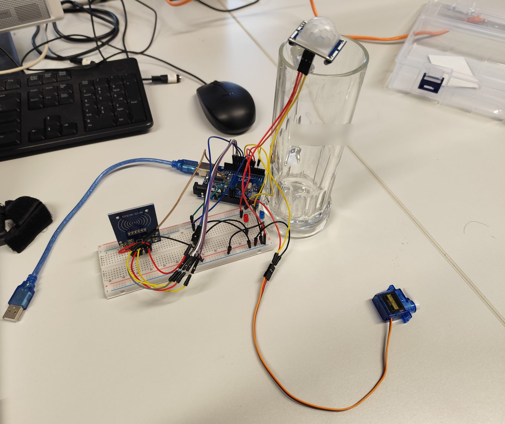
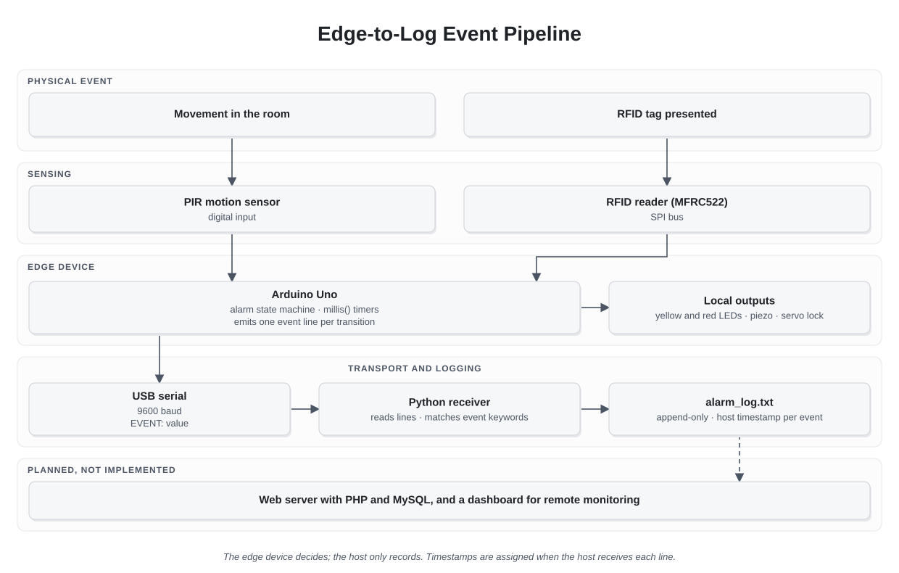
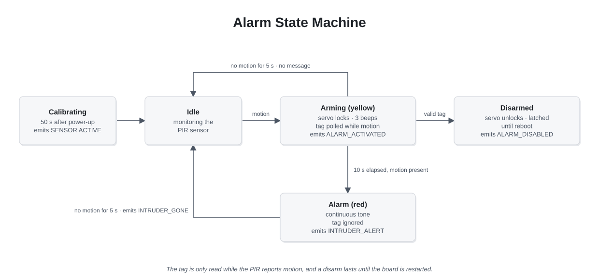

# Edge-to-Log Security Event Acquisition


**Context:** MSc course project, Data Acquisition Technologies and Sensor Networks, Constructor University · Germany · 2024

## Overview

A small home security prototype that turns physical events into a structured event log.

A motion sensor and an RFID reader feed an Arduino Uno, which runs the alarm logic on the device itself: it arms when it detects motion, gives the owner ten seconds to present an authorized tag, and raises the alarm if nobody does. Every state change is sent over USB serial as a one-line event, and a Python receiver on the computer appends it to a timestamped log file.

The interesting part is not the alarm. It is the path from a physical signal to a record that can be analyzed later, and the decisions about where each responsibility lives along that path.

<p align="center">
  
</p>

---

## Problem

The course asked for a working sensor system that acquires data from the physical world and makes it available beyond the device.

The prototype had to:

- detect presence in a room
- distinguish the owner from an intruder
- react locally with visual, audible and physical signals
- keep a record of what happened and when

The original plan was to publish the events to a web server with PHP and MySQL. The tools for that could not be installed on the available computer, so the record became a local log file written by Python. The interface between device and computer was kept generic enough to replace the file with a server later.

---

## Hardware

| Component | Role | Arduino pin |
|---|---|---|
| Arduino Uno R3 | Edge controller | |
| PIR motion sensor | Presence detection, digital output | D7 |
| MFRC522 RFID reader and tags | Owner identification over SPI | D10 (SS), D9 (RST), D11–D13 (SPI) |
| Yellow LED, with 1 kΩ resistor | Arming phase indicator | D8 |
| Red LED, with 1 kΩ resistor | Alarm phase indicator | D5 |
| Piezo buzzer | Arming beeps and continuous alarm tone | D6 |
| Positional micro servo | Simulated door lock (0° open, 90° locked) | D3 |

The PIR sensor needs time to adapt to the room before its output is reliable, so the device spends its first 50 seconds after power-up calibrating and ignores motion during that time.

---

## Architecture

<p align="center">
  
</p>

The design splits responsibilities in two:

- **The edge device decides.** All alarm logic, timing and actuator control run on the Arduino. The alarm works the same with or without a computer connected.
- **The host only records.** The Python receiver never changes the state of the alarm. It reads event lines and writes them to a file.

That split means a failure on the computer side loses records, but never disables the alarm.

---

## Event Processing

The alarm is a small state machine driven by the PIR signal, the RFID reader and two timers built on `millis()`.

<p align="center">
  
</p>

- **Idle.** The device monitors the PIR sensor.
- **Arming.** When motion is detected, the yellow LED turns on, the servo locks, the buzzer beeps three times and the RFID reader starts polling. The owner has ten seconds.
- **Disarmed.** An authorized tag turns everything off and unlocks the servo. The disarm is latched, as in a house alarm switched off at the door, and only a restart arms the system again.
- **Alarm.** If the ten seconds pass while motion continues, the red LED turns on and the buzzer sounds continuously. Tags are ignored in this state.
- **Reset.** After five seconds without motion, the device returns to idle.

---

## Signal and Event Protocol

The device sends human-readable lines at 9600 baud. Lines that start with an event keyword are the contract with the receiver; everything else, such as calibration progress, is diagnostic output that the receiver ignores.

| Line sent by the device | When | Logged as |
|---|---|---|
| `ALARM_ACTIVATED: <uptime s>` | Entering the arming phase | `ALARM_ACTIVATED` |
| `RFID_AUTHORIZED: <tag UID>` | An authorized tag is read | `RFID_AUTHORIZED: <tag UID>` |
| `ALARM_DISABLED: 0` | Right after an authorized tag | `ALARM_DISABLED: Owner (RFID)` |
| `INTRUDER_ALERT: <uptime s>` | Entering the alarm phase | `INTRUDER_ALERT` |
| `INTRUDER_GONE: <seconds>` | Returning to idle after an alarm | `INTRUDER_GONE: <seconds>` |

---

## Logging

The receiver opens the serial port, reads one line at a time, matches it against the event keywords and appends a line to `alarm_log.txt` with the computer's date and time. The file is opened in append mode for every event, so a crash of the receiver never rewrites earlier records.

An extract of the log recorded during testing, with the tag UID redacted:

```text
2024-10-15 19:37:07 - ALARM_ACTIVATED
2024-10-15 19:37:12 - RFID_AUTHORIZED: [' XX XX XX XX']
2024-10-15 19:37:12 - ALARM_DISABLED: Owner (RFID)
2024-10-23 10:23:33 - ALARM_ACTIVATED
```

In the first sequence, the owner disarmed the system five seconds after it armed.

The source code is in [`source/`](./source/): the Arduino sketch and the Python receiver, as submitted, with only the tag UID redacted.

---

## Trade-Offs and Known Issues

Reviewing the code again, with more experience, shows several limitations. Some were deliberate trade-offs for a course prototype; others are defects worth naming.

### Timestamps Belong to the Receiver, Not the Event

The device sends its uptime with each event, but the receiver discards it and stamps the time of reception. If the receiver is not running, events are lost entirely, because the device keeps no buffer.

### The Owner Can Only Disarm While Moving

The RFID reader is polled inside the branch that handles active motion. If the owner stands still in front of the reader and the PIR output drops, the tag is not read.

### Not Fully Non-Blocking

Timers use `millis()`, but the three arming beeps block for about 1.2 seconds and each RFID poll adds an 80 ms delay. During those pauses, nothing else is checked.

### A Misleading Duration

`INTRUDER_GONE` reports the time since motion was first detected, including the arming phase, not the duration of the alarm phase.

### Fragile Parsing

The receiver matches keywords as substrings and stores the tag UID as a Python list representation. A diagnostic line that happened to contain a keyword would be logged as an event.

### UID-Only Authorization

The authorized tag is hard-coded in the firmware, so changing it requires reflashing the board. A tag UID alone is also an identifier, not a secret, and many tags can be cloned.

### Documentation Drift

The written report describes a ten-second reset and an authorized UID stored as a byte array. The code uses five seconds and compares a text string, and the byte array is never used. Even a project of this size drifted between documentation and implementation.

---

## Lessons Learned

### 1. Put Decisions at the Edge and Records at the Host

Keeping the alarm logic on the device made it independent of the computer. The same principle applies to any data pipeline: the component closest to the event should own the decision, and downstream components should only observe it.

### 2. A Text Protocol Is Still a Contract

The serial lines worked because both sides agreed on keywords. Writing that agreement down as a format, with a type, a device timestamp and a sequence number, would have made the receiver simpler and the log more trustworthy.

### 3. Capture Time Where the Event Happens

A timestamp assigned on arrival measures the transport, not the event. For security events, the difference matters.

### 4. A Workaround Can Preserve the Architecture

Replacing the planned server with a local file did not change the device or the protocol. Because the boundary stayed in the same place, the file can later be replaced by a server without touching the firmware.

---

## Future Improvements

- Send structured events (for example, one JSON object per line) with type, device uptime and a sequence number, so lost events can be detected.
- Buffer events on the device until the receiver acknowledges them.
- Poll the RFID reader in every armed state, independent of motion.
- Replace blocking delays with timer-driven buzzer patterns.
- Allow re-arming with the authorized tag instead of a restart.
- Store authorized tags in EEPROM so they can be changed without reflashing.
- Complete the original goal: send events over HTTP to a server, store them in a database and show them in a web dashboard with notifications.
